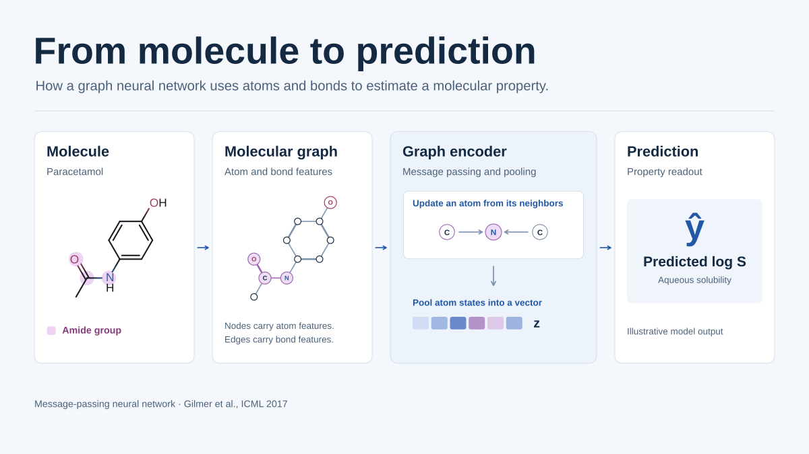

# Chem Slides

Chem Slides is an offline Agent Skill for Codex and Claude Code. It uses the Reymond group's SmilesDrawer to render chemical structures from SMILES and compose editable SVG figures for articles and presentations.



[Editable molecular encoder SVG](skills/chem-slides/examples/molecular-encoder/molecular-encoder.svg) · [Scaffold enumeration slide](skills/chem-slides/examples/scaffold-library/scaffold-library.png)

## Install

From the project that will use the skill:

```sh
npx skills add tagirshin/chem-slides --skill chem-slides
```

Choose Codex, Claude Code, or both when prompted. The [Vercel skills CLI](https://github.com/vercel-labs/skills) requires Node.js 22.20 or later. The bundled renderer runs on Node.js 20 or later.

For offline installation, download **Source code (zip)** from [GitHub Releases](https://github.com/tagirshin/chem-slides/releases/latest), then run this from the unpacked folder:

```sh
node install.mjs both
```

The same installer works from a Git checkout. Pass `codex` or `claude` to install for one client, or run it by its absolute path from your project with `--project` for a project-level install.

## Try it

Start a new agent session and give it this prompt:

> Use the chem-slides skill to reproduce the bundled “From molecule to prediction” example as an editable 16:9 SVG named `workflow.svg`. Keep the molecule, graph, encoder, and property readout in the same order.

The demo also runs directly from the checkout or release ZIP:

```sh
node skills/chem-slides/examples/molecular-encoder/draw.mjs > workflow.svg
```

## Use the renderer

```sh
node skills/chem-slides/scripts/chem-slides.mjs render 'CC[OH:2]' \
  --theme slide --highlight 2 -o ethanol.svg

node skills/chem-slides/scripts/chem-slides.mjs figure \
  skills/chem-slides/examples/slide.json -o comparison.svg
```

## Examples

- [From molecule to prediction](skills/chem-slides/examples/molecular-encoder/README.md) follows a molecule through a graph, a message-passing encoder, and a property readout.
- [One scaffold, four candidates](skills/chem-slides/examples/scaffold-library/README.md) shows how two attachment sites and two fragment choices per site define a virtual library.
- [From indigo to Tyrian purple](skills/chem-slides/examples/indigoids/README.md) aligns a shared scaffold and highlights bromine substitutions in an editorial figure.
- [Azobenzene photoswitch](skills/chem-slides/examples/photoswitch/README.md) illustrates reversible isomerization in a 16:9 presentation slide.
- The [SynthEx panel](skills/chem-slides/examples/synthex/README.md) adds bond and ring highlights with a validated editable overlay.
- The same comparison renders in [paper](skills/chem-slides/examples/paper.svg), [slide](skills/chem-slides/examples/slide.svg), and [dark](skills/chem-slides/examples/dark.svg) themes using the [figure specification](skills/chem-slides/references/format.md).

## Development

Run `node test/chem-slides.test.mjs` from the repository root. Regenerate the vendored dependencies with `npm ci --prefix build` and `node build/rebuild.mjs`.

The skill follows the [Agent Skills specification](https://agentskills.io/specification).

## License

Chem Slides code is [MIT licensed](LICENSE). The [third-party notices](skills/chem-slides/scripts/third-party-licenses.txt) cover the bundled dependencies, including SmilesDrawer 2.4.2. Cite Daniel Probst and Jean-Louis Reymond when using the renderer. [SmilesDrawer, J. Chem. Inf. Model. (2018)](https://doi.org/10.1021/acs.jcim.7b00425)

The [adapted SynthEx panel and figure specification](skills/chem-slides/examples/synthex/README.md) are licensed [CC BY-SA 4.0](https://creativecommons.org/licenses/by-sa/4.0/).
