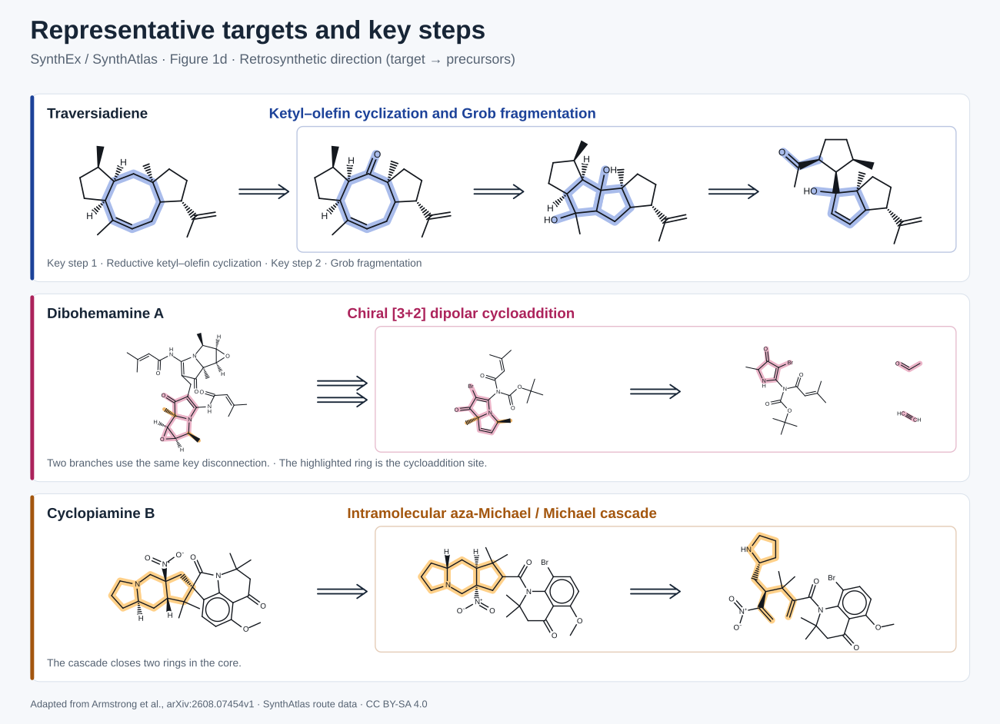

# Chem Slides

Chem Slides is an offline Agent Skill for Codex and Claude Code. It uses the Reymond group's SmilesDrawer to render chemical structures from SMILES and compose editable SVG figures for articles and presentations.



## Install

Clone the private repository using a GitHub account with access. From the checkout, run with Node.js 20 or later:

```sh
node install.mjs both
```

Use `codex` or `claude` for one client. For a project-level install, run the installer by its absolute path from the target project with `--project`. The renderer and its dependencies are bundled.

The [Vercel skills CLI](https://github.com/vercel-labs/skills) can install from a local checkout. Run this from the project that will use the skill:

```sh
DISABLE_TELEMETRY=1 npx skills add /path/to/chem-slides --skill chem-slides --agent codex claude-code --copy
```

Start a new agent session and ask it to use the `chem-slides` skill. For manual installation, copy the entire [skill folder](skills/chem-slides) into `~/.agents/skills/` for Codex or `~/.claude/skills/` for Claude Code.

## Use the renderer

```sh
node skills/chem-slides/scripts/chem-slides.mjs render 'CC[OH:2]' \
  --theme slide --highlight 2 -o ethanol.svg

node skills/chem-slides/scripts/chem-slides.mjs figure \
  skills/chem-slides/examples/slide.json -o comparison.svg

node skills/chem-slides/examples/synthex/draw-panel.mjs > panel-d.svg
```

The examples include [paper](skills/chem-slides/examples/paper.svg), [slide](skills/chem-slides/examples/slide.svg), and [dark](skills/chem-slides/examples/dark.svg) versions of a comparison. The [SynthEx example](skills/chem-slides/examples/synthex/README.md) adds bond and ring highlights with a validated editable overlay. See the [figure specification](skills/chem-slides/references/format.md) for styling and layout options.

## Development

Run `node test/chem-slides.test.mjs` from the repository root. Regenerate the vendored dependencies with `npm ci --prefix build` and `node build/rebuild.mjs`.

The skill follows the [Agent Skills specification](https://agentskills.io/specification). See the [third-party notices](skills/chem-slides/scripts/third-party-licenses.txt) for bundled dependencies. SmilesDrawer 2.4.2 is distributed under the MIT license. Cite Daniel Probst and Jean-Louis Reymond, [SmilesDrawer, J. Chem. Inf. Model. (2018)](https://doi.org/10.1021/acs.jcim.7b00425). The adapted SynthEx panel and figure specification are licensed [CC BY-SA 4.0](https://creativecommons.org/licenses/by-sa/4.0/).
